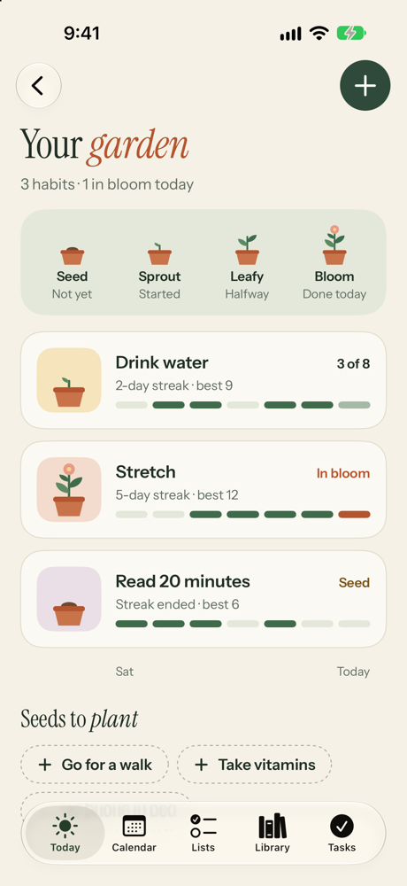
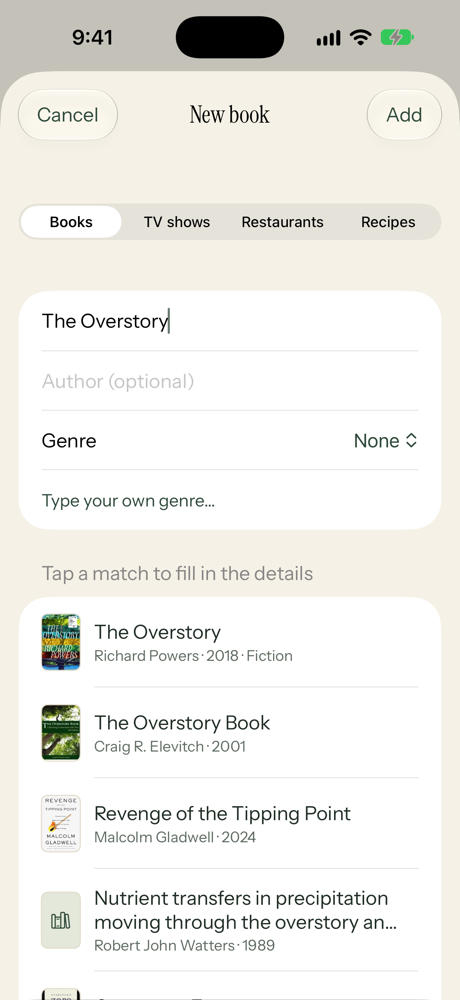
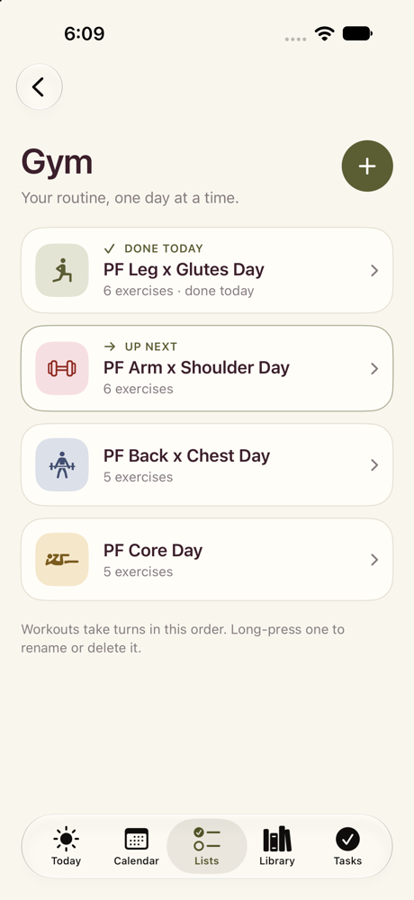
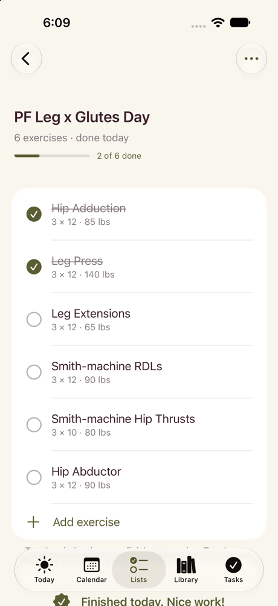

# Everyday

A calm iPhone app for your day: tasks, reminders, lists, your calendar, daily habits, your gym
routine, and the books, shows, restaurants and recipes you want to get to, all in one place.
It has a greenhouse look: cream and fern green, terracotta pots, and habits that grow into plants.
Built with SwiftUI and SwiftData.

  
  &nbsp;
  

## Features

### Today
See what's coming up on your calendar and what's on your list for today. Below that are your
habits, your next workout and **Up next**: the book you're reading and the show you're watching (tap one
to open it). Tap **+** to add a task, a reminder or a calendar event.

  

### Calendar
A week view with your events from Google, Outlook and iCloud alongside your tasks.
Events are colored by Work and Personal. If you've moved to another day or week, tap **Today**
to jump back. You can create, edit and delete events, choose which
calendar they go in, and set an alert. Pull down to fetch the latest changes.

  

### Tasks and reminders
Tasks are grouped into Overdue, Today, Upcoming, Someday and Done. Give a task a time, a
place, a note and an icon. Reminders send a notification at the time you choose, and
repeating tasks (every day, weekday, week or month) move to their next date when you check
them off. Turn on **Add to calendar** to put a task on your real calendar.

  
  &nbsp;
  
  &nbsp;
  

### Habits
Track the small things you want to do every day, like "Stretch" or "Drink water" (8 times).
Each habit is a plant on the **Plant shelf** on Today. Tap it to water it (check in).
Long-press a plant for more options.

The plants are a little game. Each day you do a habit, its plant grows, and over time it moves
through six stages: **Seed**, **Sprout** (1 day), **Leafy** (3 days), **Bud** (1 week), **Bloom**
(2 weeks) and **Flourish** (30 days). Miss a day and the plant droops and turns **thirsty**.
The first missed day is free, but every day after that in a row costs a day of growth. A bar on
each pot shows how close it is to the next stage. Watering it into a new
stage pops up a little celebration.

Tap **All habits** to open **Your garden**. There you can see each habit's stage, its streak,
your best, and the last 7 days. **Forgot to log a day?** Tap any of the last 7 days to mark it
done or not done. To fix an older day, open the habit and use the **Past 5 weeks** calendar.
You can also add, edit, reorder and delete habits, and set a daily reminder. Under **Seeds to
plant**, tap a suggestion to add it.

  

### Lists
Keep lists for anything: groceries, weekend chores, books to read. Grocery items can have a
quantity and a section (like Produce), and checked items move to "In the basket". Lists can
be renamed and given their own icon and color.

  

### Library
Save books you want to read, TV shows you want to watch, restaurants you want to try and
recipes you want to cook.
Books and shows move from **Want to read** to **Reading** to **Finished** (or the watching
versions) with a single tap; restaurants go from **Want to try** to **Been there**, and recipes go from **This week** to **Made it**. Give each a
genre or cuisine, filter by it, and rate what you've finished with 1–5 stars. Tap a section's
heading to fold it away.

Start typing a title and pick a match to fill in the details for you: the author or network,
the genre and a cover. Books come from [Open Library](https://openlibrary.org), shows from
[TVmaze](https://www.tvmaze.com) and restaurants from Apple Maps, so no account is needed.
Long-press a restaurant and choose **Plan a visit** to put it on your calendar.

**Recipes:** paste a link to a recipe and tap **Get the recipe from this link**. The app fills in
the name, photo, time, ingredients and steps. This works with most recipe sites and with
TikTok videos. For TikTok, the app reads the video's caption, and if the caption links to the
full recipe, it uses that page. You can add a recipe's ingredients to one of your lists (a
grocery list, say) with one tap.

  

### Gym
Keep your workout routine in the app. Copy it from the Notes app and tap **Paste from Notes**;
each day (like "Leg x Glutes Day") becomes a workout, and the days take turns in order. Find it on Today or at the top of the **Lists** tab.

- **Set by set:** at the gym, tap each set when you finish it. If you got fewer reps than
  planned, tap the set again to change the number. The bar at the top counts your sets,
  finished exercises turn green, and the next one is outlined as **Up next**.
- **Rest timer:** finishing a set starts a rest countdown. It shows on the Lock Screen and in
  the Dynamic Island, and your phone buzzes when it's time for the next set.
- **Next time:** when you tap **Finish workout**, the app suggests going up 5 lbs on exercises
  where you got every rep, and staying at the same weight where you didn't.
- **Progress:** a **Best!** badge shows when you beat your best weight. The Gym screen
  shows your recent personal bests and how far you've come. Tap an exercise to see its history.
- **Schedule and reminders:** choose your gym days and the app plans which workout falls on
  each one. It can also remind you on gym days at a time you choose.
- **Apple Health:** you can turn on saving finished workouts to Health as strength training, with
  an estimate of the calories you burned. Turn it on in **Schedule & Health** on the Gym screen.

  
  &nbsp;
  

### Search
The magnifying glass at the top of each tab searches everything at once: tasks, list items,
lists, books, shows, restaurants, recipes and calendar events.

### Home screen widget
Add the **Today** widget to see your next events and today's tasks without opening the app.
It comes in small, medium and large sizes. To add it, long-press your home screen, tap
**Edit → Add Widget** and choose **Everyday**.

### Look and feel
Headings use [Instrument Serif](https://fonts.google.com/specimen/Instrument+Serif), with
its italic for single-word accents (like your name in "Good morning, *Aubri*"). Everything
else uses [Instrument Sans](https://fonts.google.com/specimen/Instrument+Sans). Both fonts
still follow your iPhone's text size setting. The colors are cream, fern green, sage,
terracotta and honey. Lists can be Sage, Clay, Honey or Bloom.

### Light and dark mode
Follows your iPhone's setting, or pick Light or Dark yourself by tapping your profile picture
(or initials) on the Today screen. That's also where you set your name and photo. The app icon has light, dark and tinted versions.

## Running the app

1. Open `EverydayApp.xcodeproj` in Xcode.
2. Choose an iPhone simulator or your own iPhone, then press **Run** (⌘R).
3. To see the app filled in, go to the **Lists** tab and tap **Load sample data**. It adds
   lists, tasks, Library items, three habits and a four-day gym routine.

The app asks for these permissions:

- **Calendar:** to show, add and edit your events. Your Google or Outlook calendars appear once
  those accounts are added in iPhone **Settings → Apps → Calendar → Calendar Accounts**.
- **Notifications:** for task, habit and gym reminders and the rest timer.
- **Apple Health** (only if you turn it on): to save finished workouts. The app also reads your
  weight to estimate calories.

### Running it on your own iPhone

The simulator works as is. To install the app on a real iPhone, Xcode has to sign it with your
own Apple account, so swap in your own IDs first:

1. In Xcode, select the **EverydayApp** project, then for both the **EverydayApp** and
   **EverydayWidgetExtension** targets open **Signing & Capabilities** and choose your **Team**.
2. Change both bundle identifiers from `com.aubribowmanpersonalteam…` to your own, for example
   `com.yourname.EverydayApp` and `com.yourname.EverydayApp.EverydayWidget`.
3. The app and widget share data through an App Group. Change
   `group.com.aubribowmanpersonalteam.EverydayApp` to `group.com.yourname.EverydayApp` in all four
   places it appears: `EverydayApp.entitlements`, `EverydayWidget.entitlements`,
   `EverydayApp/Shared/WidgetSync.swift` and `EverydayWidget/WidgetSnapshot.swift`.

If Xcode says your account can't use a capability (Apple Health or App Groups can need a paid
developer account), remove it under **Signing & Capabilities**. The rest of the app still works;
only Health saving or the widget's data is affected.

## Project layout

The app's code is in `EverydayApp/`, with one folder per part of the app:

| Folder | What's inside |
| --- | --- |
| `App/` | `EverydayApp.swift` (app entry point: storage, the calendar connection and Light/Dark mode), `ContentView.swift` (the five tabs, and keeping reminders and calendars up to date) and `SampleData.swift` (the demo data behind **Load sample data**) |
| `Today/` | The Today screen, and `Profile.swift` for your profile picture and the round avatar |
| `Calendar/` | The Calendar screen, adding and editing events, calendar settings, event cards, and `CalendarStore.swift`, which reads and writes events through Apple's EventKit |
| `Tasks/` | The Tasks screen and the screen for a single task |
| `Lists/` | The Lists screen and the screen for a single list |
| `Library/` | The Library screen; `LibraryLookup.swift` looks up books, shows and restaurants as you type; `RecipeImporter.swift` and `TikTokRecipe.swift` read a recipe from a website link or a TikTok video |
| `Habits/` | Daily habits (`Habits.swift`: check-ins and streaks), the Your garden screen (`HabitsView.swift`) and the potted plants and growth stages (`PlantShelf.swift`) |
| `Gym/` | Workouts, sets, weight history, personal bests, gym days and reading a routine pasted from Notes (`Gym.swift`); the Gym screens (`GymView.swift`); saving to Apple Health (`GymHealth.swift`); and the rest countdown on the Lock Screen and Dynamic Island (`RestTimer.swift`) |
| `Shared/` | Used across the app: `Models.swift` (tasks, lists and Library items, including the repeat logic), `Components.swift` (checkboxes, rows and cards), `Sheets.swift` (pop-ups for adding things and settings), `Theme.swift` (colors, fonts, date formatting, appearance), `Fonts/` (the bundled Instrument font files), `Search.swift`, `Reminders.swift` (task, habit and gym-day notifications) and `WidgetSync.swift` (shares today's plans with the widget) |

`EverydayWidget/` (next to `EverydayApp/`) is the home screen widget and the rest timer's Lock Screen view, a separate part of the app that iOS runs on its own.

New files go in the folder for their part of the app. Xcode picks them up automatically.

## Credits

Instrument Serif and Instrument Sans were made by [Instrument](https://www.instrument.com) and are free to use under the
[SIL Open Font License](EverydayApp/Shared/Fonts/OFL.txt). They're bundled in `EverydayApp/Shared/Fonts/`
and loaded when the app starts (see `AppFonts` in `Theme.swift`).
