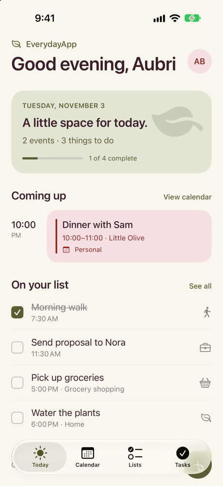
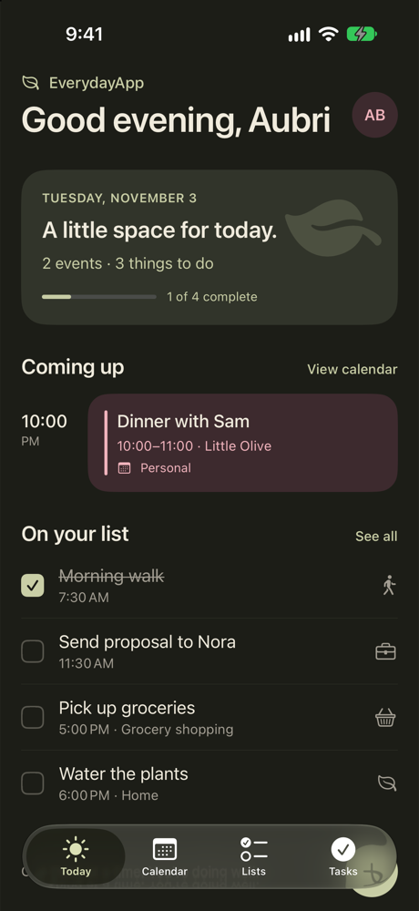
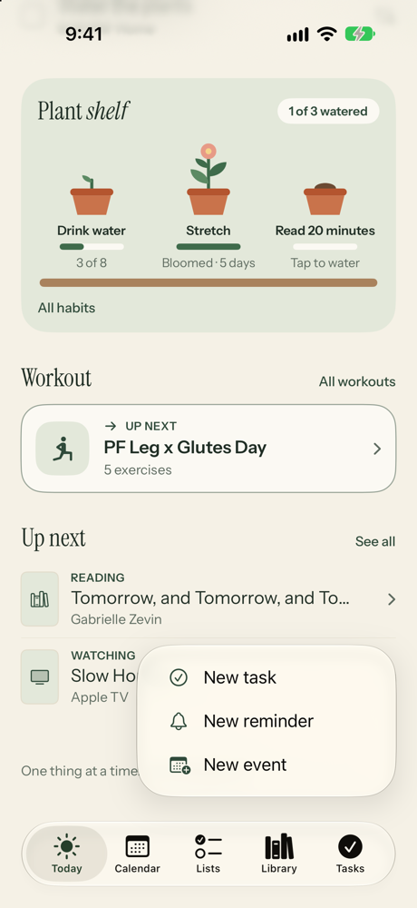
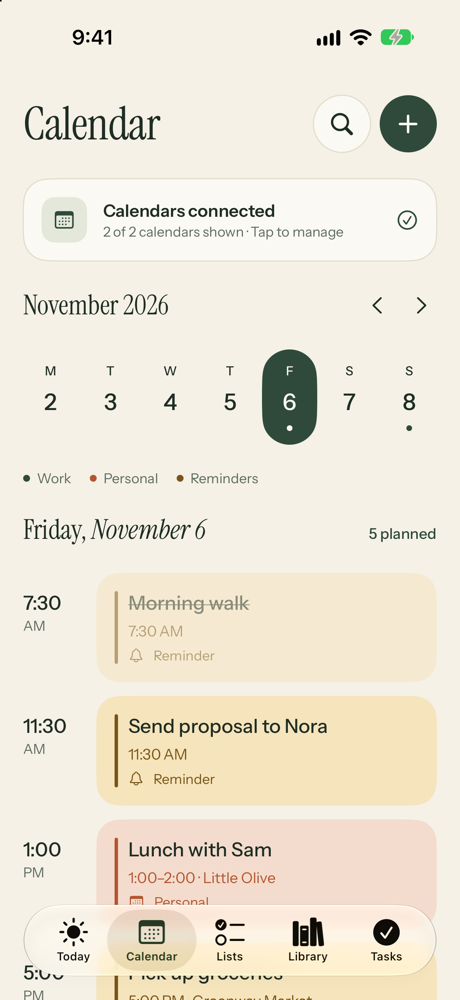
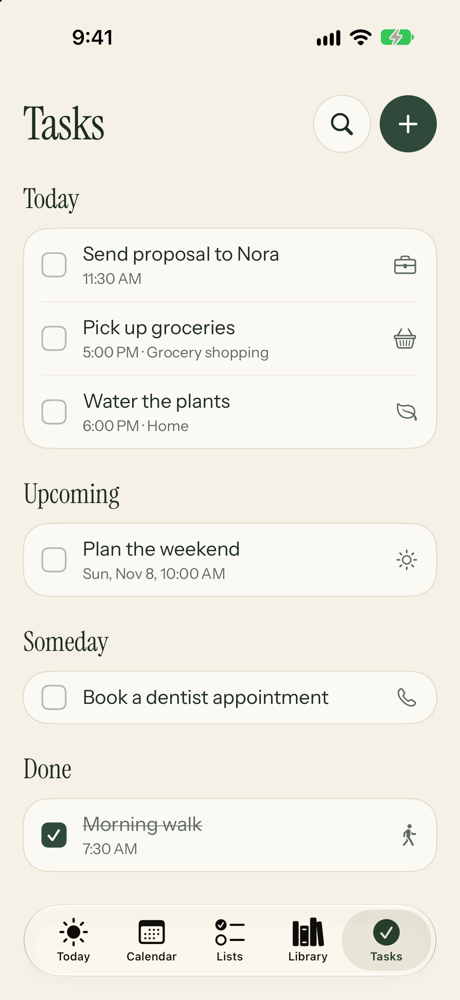
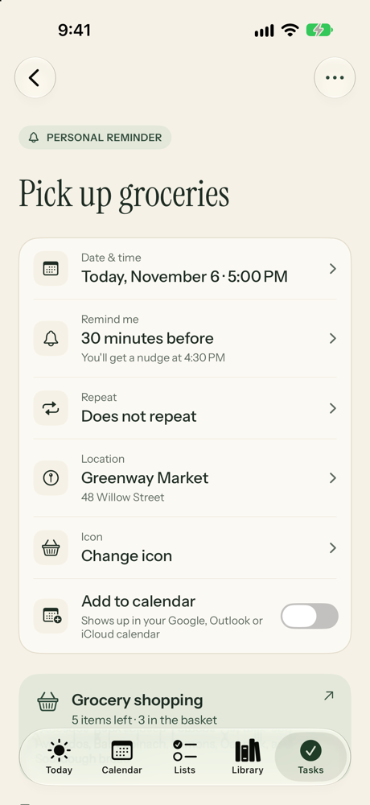
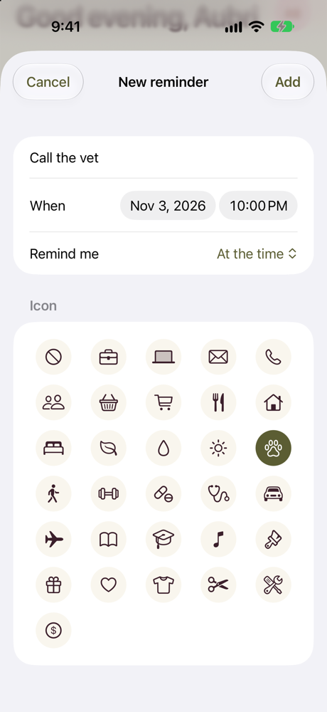
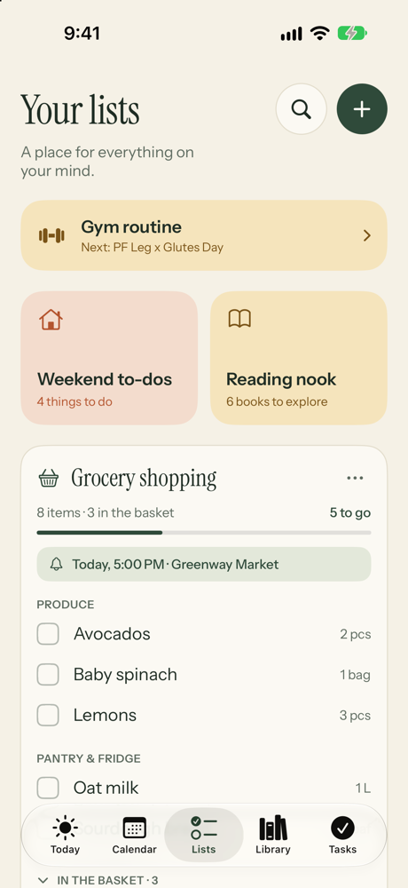

# Everyday

A calm iPhone app for your day: tasks, reminders, lists, your calendar and the books and shows
you want to get to, all in one place.
Built with SwiftUI and SwiftData.

  
  &nbsp;
  

## Features

### Today
See what's coming up on your calendar and what's on your list for today. Tap **+** to add a
task, a reminder or a calendar event.

  

### Calendar
A week view with your events from Google, Outlook and iCloud alongside your tasks.
Events are colored by Work and Personal. You can create, edit and delete events, choose which
calendar they go in, and set an alert. Pull down to fetch the latest changes.

  

### Tasks and reminders
Tasks are grouped into Overdue, Today, Upcoming, Someday and Done. Give a task a time, a
place, a note and an icon. Reminders send a notification at the time you choose, and
repeating tasks (every day, weekday, week or month) move to their next date when you check
them off. Turn on **Add to calendar** to put a task on your real calendar.

  
  &nbsp;
  
  &nbsp;
  

### Lists
Keep lists for anything: groceries, weekend chores, books to read. Grocery items can have a
quantity and a section (like Produce), and checked items move to "In the basket". Lists can
be renamed and given their own icon and color.

  

### Library
Save books you want to read and TV shows you want to watch. Each one moves from
**Want to read** to **Reading** to **Finished** (or the watching versions for shows) with a
single tap, and can hold the author or streaming service plus a note.

### Light and dark mode
Follows your iPhone's setting, or pick Light or Dark yourself by tapping your initials on the
Today screen. The app icon has light, dark and tinted versions.

## Running the app

1. Open `EverydayApp.xcodeproj` in Xcode.
2. Choose an iPhone simulator or your own iPhone, then press **Run** (⌘R).
3. To see the app filled in, go to the **Lists** tab and tap **Load sample data**.

The app asks for two permissions:

- **Calendar:** to show, add and edit your events. Your Google or Outlook calendars appear once
  those accounts are added in iPhone **Settings → Apps → Calendar → Calendar Accounts**.
- **Notifications:** to send task reminders.

## Project layout

| File | What it does |
| --- | --- |
| `EverydayApp.swift` | App entry point; sets up storage, the calendar connection and Light/Dark mode |
| `ContentView.swift` | The five tabs, plus keeping reminders and calendars up to date |
| `TodayView.swift`, `CalendarView.swift`, `ListsView.swift`, `LibraryView.swift`, `TasksView.swift` | The five main screens |
| `TaskDetailView.swift`, `ListDetailView.swift` | Screens for a single task or list |
| `Sheets.swift`, `EventEditSheet.swift`, `CalendarSettingsSheet.swift` | Pop-up screens for adding and editing |
| `Models.swift` | Tasks, lists, and Library books and shows, including the repeat logic |
| `CalendarStore.swift` | Reads and writes calendar events through Apple's EventKit |
| `Reminders.swift` | Schedules task notifications |
| `Components.swift`, `EventCard.swift` | Reusable pieces like checkboxes, rows and cards |
| `Theme.swift` | Colors (light and dark), date formatting and appearance settings |
| `SampleData.swift` | The demo data behind **Load sample data** |
